# Eiomra MediCare

Eiomra MediCare is a Laravel, React, and TypeScript hospital and clinic management system for patient records, doctors, appointments, medical records, billing, pharmacy, lab results, staff roles, and administration.

The application includes a public homepage, authentication screens, admin dashboard, patient dashboard, clinical modules, billing workflows, and medical operations pages.

## Screenshots

| Home | Dashboard | Patients |
| --- | --- | --- |
| 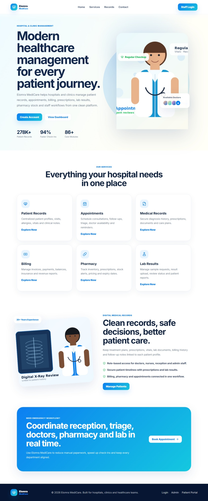 | 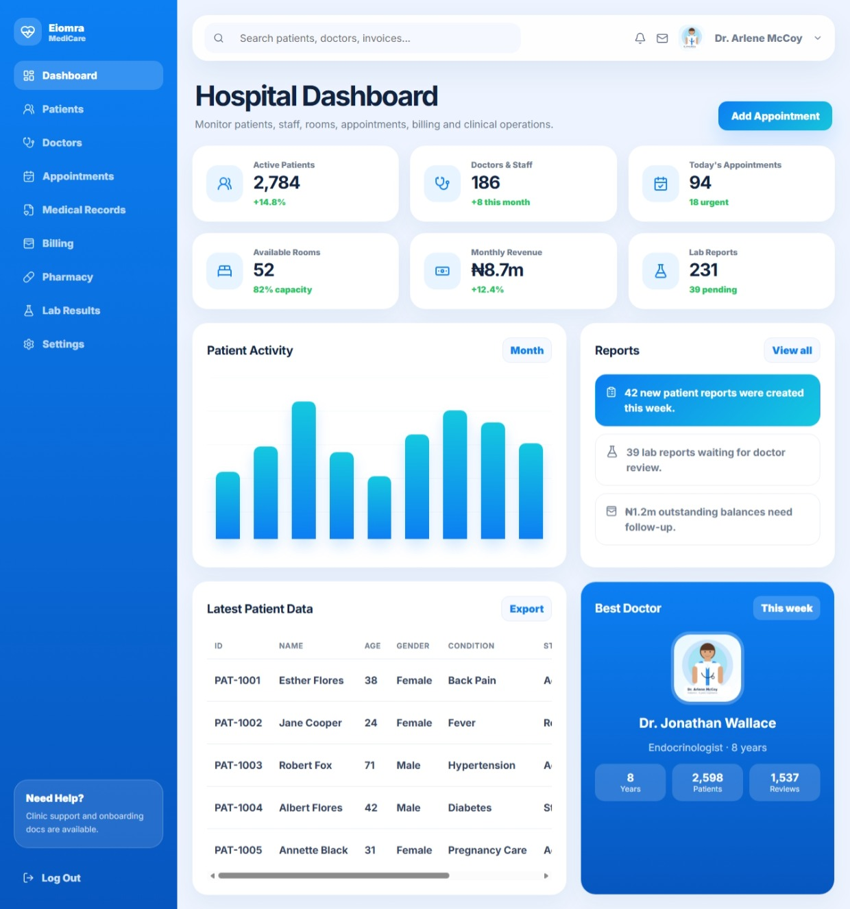 | 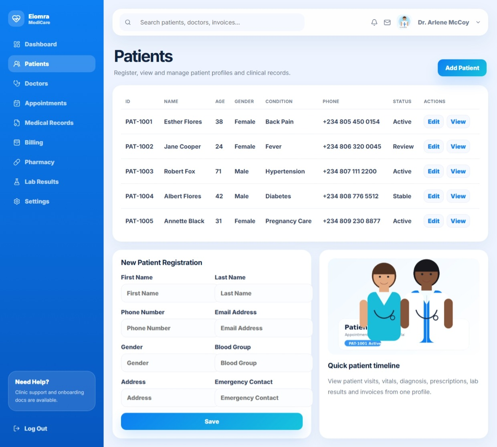 |

| Doctors | Appointments | Medical Records |
| --- | --- | --- |
| 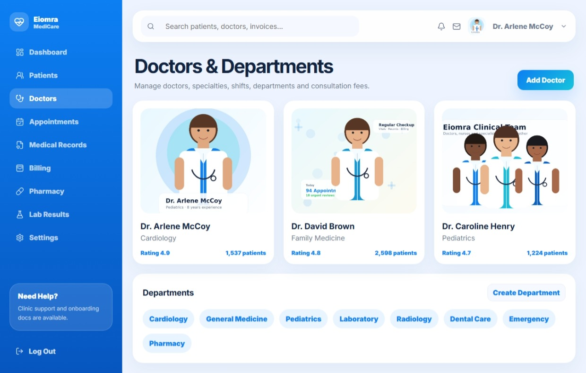 | 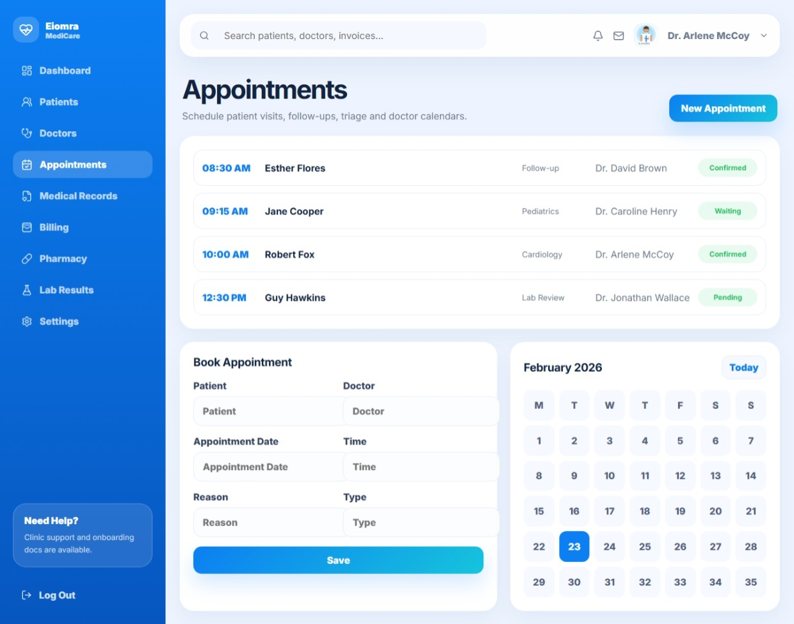 | 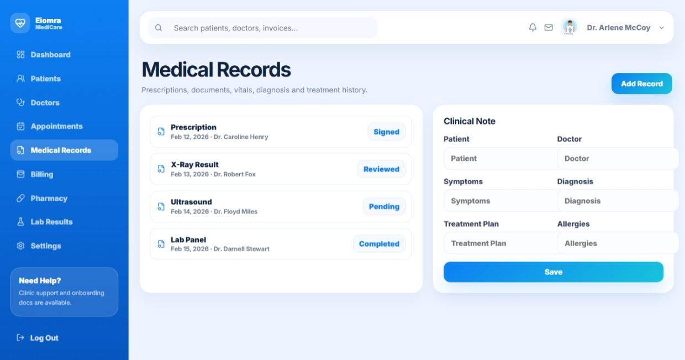 |

| Billing | Pharmacy | Lab |
| --- | --- | --- |
| 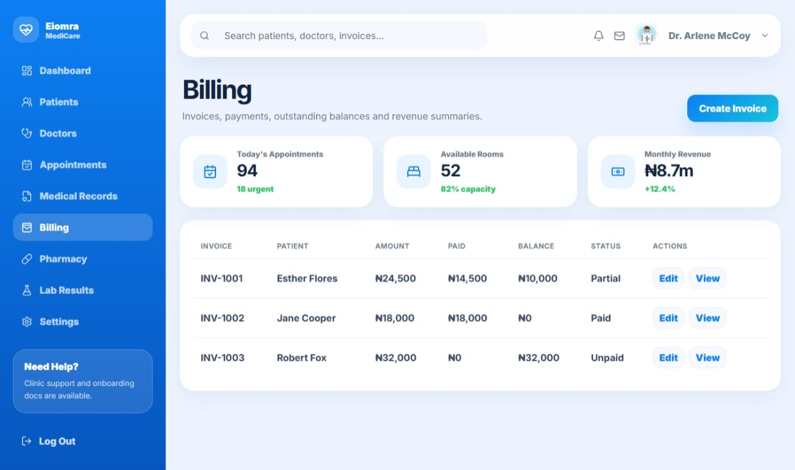 | 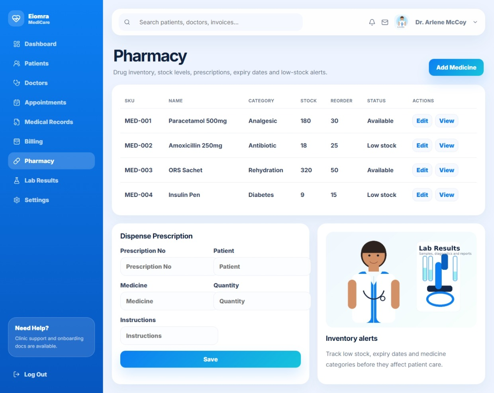 | 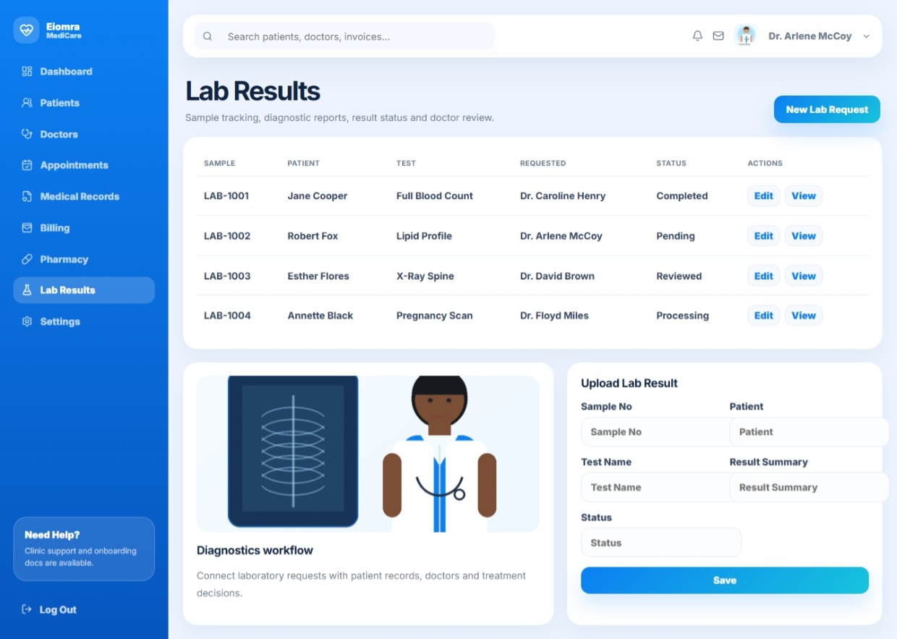 |

| Staff | Login | Register |
| --- | --- | --- |
| 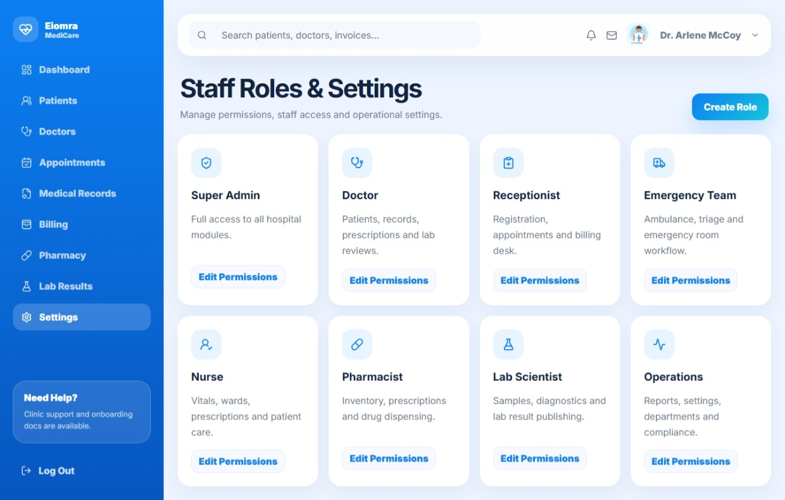 | 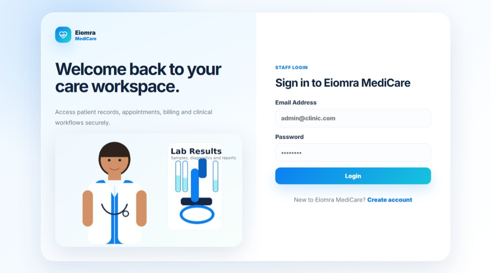 | 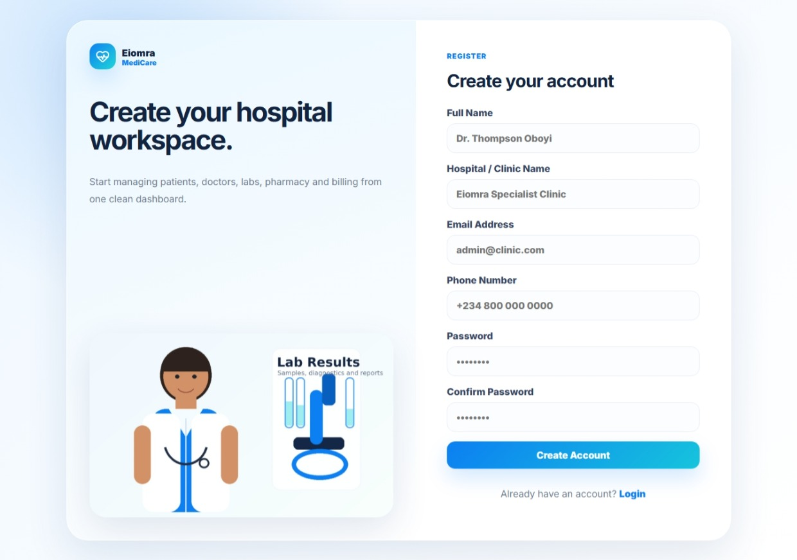 |

## Features

- Public clinic and hospital homepage
- Admin dashboard for healthcare operations
- Patient/user dashboard
- Patient records
- Doctors and departments
- Appointment management
- Medical records
- Billing and invoices
- Pharmacy inventory and prescriptions
- Lab results
- Staff roles and settings
- React + TypeScript frontend with custom CSS
- Laravel migrations, seeders, and raw SQL schema

## Tech Stack

- Laravel 11/12 compatible structure
- PHP 8.2+
- MySQL or MariaDB
- React
- TypeScript
- Vite
- Custom CSS

## Requirements

- PHP 8.2 or newer
- Composer
- Node.js and npm
- MySQL or MariaDB

## Setup

```bash
cd Eiomra-Medicare
composer install
npm install
cp .env.example .env
php artisan key:generate
```

Create a MySQL database, then update `.env`:

```env
DB_CONNECTION=mysql
DB_HOST=127.0.0.1
DB_PORT=3306
DB_DATABASE=eiomra_medicare
DB_USERNAME=root
DB_PASSWORD=
```

Run migrations and seeders:

```bash
php artisan migrate --seed
```

Start the app:

```bash
npm run dev
php artisan serve
```

Open:

```text
http://127.0.0.1:8000
```

## Main Pages

- `/`
- `/login`
- `/register`
- `/admin`
- `/dashboard`
- `/patients`
- `/doctors`
- `/appointments`
- `/records`
- `/billing`
- `/pharmacy`
- `/labs`
- `/settings`

## SQL Schema

The project includes Laravel migrations and a raw MySQL schema:

```text
database/migrations/2026_06_23_000000_create_eiomra_medicare_tables.php
database/schema.sql
```

## Notes

This is a starter healthcare management system with demo data and UI workflows. Add production authentication, authorization, patient privacy controls, audit trails, and secure file handling before using it in production.
